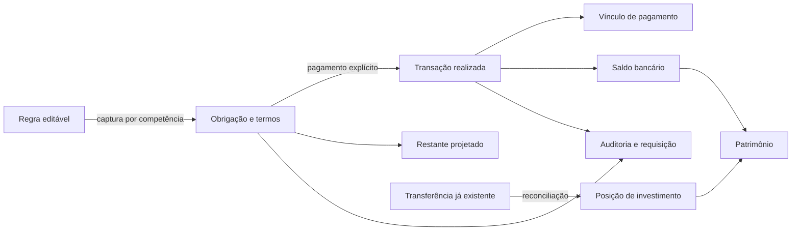

# Auditoria estrutural financeira — 15/10/2026

**Atualização operacional de 16/10/2026:** [publicacao-operacional.md](publicacao-operacional.md). A missão de liberação resolveu a integração isolada (12/12) e verificou backup/restauração com 013+014 sobre cópia dos dados reais, sem alterar produção. Os legados podem ser preservados sem bloquear os demais módulos. Publicação aguarda confirmação antes da primeira migration remota; as restrições da auditoria geral abaixo são histórico, não um novo bloqueio operacional automático.

**AUDITORIA ESTRUTURAL APROVADA: NÃO.**
**HOTFIX 013 APTO PARA PUBLICAÇÃO: NÃO.**

**Continuação local em 15/10/2026:** resultados atuais em [continuacao-auditoria-local.md](continuacao-auditoria-local.md) e na seção 9. O resultado 46/47 abaixo é histórico da entrega `62d69ac`; as novas execuções globais e de UI passaram. Houve diagnóstico remoto autorizado, estritamente somente leitura. Auth/PostgREST isolados e conferência dos legados ainda bloqueiam publicação.

A base `fe99595b49cf92f3e1b50a15679277d6cae8ecfc`, da branch `codex/hotfix-reserva-cemig`, contém falhas financeiras reproduzidas além da Cemig. Esta entrega prepara correções na branch local `codex/auditoria-estrutural-financeira`, incluindo a migration incremental **014**, sem modificar 001–013. A aprovação operacional continua bloqueada pelos limites históricos e pelos ensaios de integração descritos ao final. O hotfix 013 isolado não resolve as falhas P0 abaixo.

Referência de produção informada: `main d203c47`. Na entrega original `62d69ac`, não houve acesso ao banco financeiro remoto. Na continuação local houve somente diagnóstico agregado autorizado em transações `READ ONLY`, sem alterar dados financeiros. Não houve migration remota, push desta auditoria, merge ou deploy. Todos os testes de gravação usaram bancos descartáveis e dados sintéticos. A configuração Git da Vercel mantém desabilitado o deploy das duas branches de trabalho.

## 1. Entidades, relações e invariantes

| Camada                    | Entidades/fontes                                                                                                                              | Invariante exigido                                                                                                                                     |
| ------------------------- | --------------------------------------------------------------------------------------------------------------------------------------------- | ------------------------------------------------------------------------------------------------------------------------------------------------------ |
| Configuração editável     | `recurring_items`, configurações de cartão, termos de dívida, metadados e taxas de investimento                                               | Uma edição muda a previsão derivada; não reescreve um pagamento ou obrigação já capturada.                                                             |
| Obrigação por competência | `recurring_occurrences` com valor e `terms`; parcelas calculadas e evidências `debt_payment_allocations`; faturas por cartão/mês              | Identidade, valor devido e natureza da obrigação são independentes do movimento que a paga. Vencimento não é data de caixa.                            |
| Movimento executado       | `transactions`, status, data efetiva, origem/destino e delta de ajuste                                                                        | Só movimentos realizados até o corte afetam saldo; uma operação financeira gera um único efeito bancário.                                              |
| Evidência e auditoria     | `recurring_payments`, `debt_payments`, `card_payments`, auditorias de compras e investimentos; novos `financial_requests` e `financial_audit` | Vínculos pertencem ao mesmo usuário. Replay exato devolve resultado anterior; payload diferente é rejeitado. Correção explícita conserva antes/depois. |
| Projeção                  | `projection`, `monthlyCommitments`, relatórios e exportação                                                                                   | Previsão não movimenta dinheiro. Regra ativa gera futuro implícito; obrigação materializada e restante comprovado sobrevivem à pausa da regra.         |
| Conciliação e patrimônio  | `balanceSummary`, `wealthSummary`, posições/movimentos de investimentos, operações de reconciliação                                           | Conciliar um movimento existente não cria outro. Saldo operacional, reserva e patrimônio têm escopos distintos e identificáveis.                       |



`entity` identifica a entidade de origem; `transactionId` identifica o lançamento; `occurrenceId` identifica a competência. São referências diferentes. RLS e FKs compostas por titular protegem as relações existentes. As tabelas novas só permitem leitura direta pelo proprietário; gravação ocorre nas operações validadas.

Não existe um único número que sirva a todas as telas: despesa por compra, saída bancária, compromisso pendente e passivo patrimonial são grandezas diferentes. A consistência exigida é usar a mesma evidência, corte e definição quando a grandeza é a mesma.

## 2. Mapa de causas-raiz e falhas comprovadas

Todos os valores dos exemplos são sintéticos. A severidade considera a consequência possível, não afirma que ocorreu dano em produção.

| ID / classe | Causa-raiz e reprodução                                                                                                                                                                                                                                                       | Correção                                                                                                                                                                                                                                                                                     |
| ----------- | ----------------------------------------------------------------------------------------------------------------------------------------------------------------------------------------------------------------------------------------------------------------------------- | -------------------------------------------------------------------------------------------------------------------------------------------------------------------------------------------------------------------------------------------------------------------------------------------- |
| F01 **P0**  | A rota antiga `delete_investment` permaneceu pública após a adoção das operações simples. Excluir uma posição com aporte real apagava a transação bancária do aporte, elevando o saldo em R$ 10 no cenário de teste.                                                          | Desativar essa rota com erro explícito; revogar movimentação/ajuste antigos; manter exclusão canônica que conserva o livro bancário e bloquear vínculos inesperados.                                                                                                                         |
| F02 **P0**  | Pagamentos recorrentes comuns e complementares não recebiam a proteção já aplicada a pagamentos de dívida/cartão. Alterar diretamente R$ 40 pagos para R$ 10 elevava o banco em R$ 30 e reabria o restante.                                                                   | Trigger bloqueia exclusão e alterações financeiras diretas de transações ligadas a competências. A operação de resolução continua controlada pelo RPC.                                                                                                                                       |
| F03 **P0**  | Criação comum usava `upsert`. Repetir a criação com o mesmo UUID e valor alterado reescrevia uma despesa já executada, confundindo retry com correção. No teste, R$ 10 passaram a R$ 20 e o saldo caiu novamente.                                                             | `create_financial_transaction` vincula UUID/payload/resultado, rejeita colisões e não atualiza lançamento existente. App e criação de programados passam por esse RPC. Correção explícita comum continua disponível e passa a ter auditoria.                                                 |
| F04 **P0**  | A 013 congelava o valor, mas tipo, nome, conta, categoria e calendário ainda dependiam da regra atual. Parcial e complemento podiam usar contas diferentes após edição. Mudar início/frequência escondia uma competência `planned`.                                           | Snapshot imutável `terms`, FKs de titularidade e leitura/pagamento pela competência. Preservar vencidos antes de edições estruturais; impedir retroatividade ambígua do novo calendário. Ocorrências materializadas, inclusive futuras, sobrevivem à pausa; somente o futuro implícito para. |
| F05 **P1**  | Vencimento futuro era confundido com execução futura: um pagamento antecipado real hoje era recusado.                                                                                                                                                                         | Permitir competência futura com pagamento efetivo até hoje; conservar vencimento original e remover apenas o saldo efetivamente quitado da projeção.                                                                                                                                         |
| F06 **P1**  | Chaves de repetição de dívida/cartão não validavam sempre o payload; a fatura guardava somente a última solicitação. Repetir uma edição intermediária antiga podia substituir uma correção posterior. Resolução de lançamento já concluído aceitava ação/data contraditórias. | Diário imutável de requisições e comparação dos fatos legados verificáveis; wrappers preservam os algoritmos atômicos existentes; ação/data conflitantes são rejeitadas.                                                                                                                     |
| F07 **P1**  | Um pagamento de R$ 250 para três parcelas de R$ 100 gerava uma única evidência de obrigação de R$ 100, embora o principal baixasse R$ 250 corretamente. A quitação das competências seguintes não tinha comprovação individual.                                               | Alocar R$ 100/R$ 100/R$ 50 nas três competências, com uma única transação de R$ 250. Projeção e contador usam alocações verificadas. Restante parcial comprovado persiste após arquivamento. Não reconstruir alocações antigas por suposição.                                                |
| F08 **P1**  | Competência e data de caixa eram usadas como a mesma data. Uma conta de outubro programada para novembro descontava caixa em outubro. Quitação atrasada podia sumir do contador do mês do pagamento; exportação podia repetir a competência ao percorrer meses.               | `cashDate` separado de `due`; seleção de concluídos também pela data efetiva comprovada; deduplicação da exportação por identidade canônica. A obrigação mensal seguinte permanece independente.                                                                                             |
| F09 **P1**  | Projeção e patrimônio confiavam em comprovante de cartão sem verificar a transação/corte, enquanto o contador verificava. Pagamento posterior podia apagar passivo anterior.                                                                                                  | `verifiedCardPayments` exige movimento realizado correspondente, valor e corte; projeção e patrimônio passam a usá-lo.                                                                                                                                                                       |
| F10 **P1**  | Contador de fatura/dívida parcial financiada por reserva atribuía saída ao caixa operacional, divergindo da projeção. Compra de cartão futura já reduzia o patrimônio atual.                                                                                                  | Mesmo critério de conta de reserva no impacto pendente; patrimônio inclui compras somente até o corte, mantendo a compra futura no planejamento.                                                                                                                                             |
| F11 **P1**  | Alterações/exclusões explícitas comuns e de alguns cadastros não tinham histórico transversal de antes/depois. A exclusão de compra sem pagamento podia remover também a auditoria específica anterior.                                                                       | `financial_audit` registra eventos dos módulos financeiros, inclusive remoções de auditorias específicas; acesso direto de escrita/exclusão é revogado. Captura prospectiva, sem inventar histórico anterior à 014.                                                                          |

F04 também tem efeito financeiro P0 antes do primeiro pagamento: após salvar uma previsão específica como despesa, mudar a regra para receita fazia 001–013 registrar sua realização como entrada de dinheiro. A reprodução sintética confirma `type=income`; a regressão da 014 confirma a despesa e conta originais. Para um parcial já registrado, a 013 bloqueava a mudança de tipo no pagamento, mas ainda havia reclassificação visual e bloqueio do complemento; esses efeitos são P1.

As causas compartilhadas são: rotas de compatibilidade com permissões antigas; mistura entre comando de criação e correção; configuração usada como histórico; idempotência sem payload permanente; pagamento agregado sem alocação por competência; mistura de corte/competência/caixa; verificadores divergentes entre consumidores; auditoria incompleta. F06 também foi reproduzida em `adjust_card_purchase`: a mesma chave com outro valor retornava sucesso mantendo o ajuste anterior. O mesmo diário agora rejeita esse replay incompatível.

### Evidência negativa e limites das reproduções

- `scripts/reproduce-financial-audit.mjs` aplica somente 001–013 em PGlite novo e afirma as falhas financeiras descritas, incluindo edição de pagamento, exclusão antiga e retry alterado. É uma reprodução da base vulnerável, não um comando de reparo.
- As seis primeiras regressões de `tests/structural.test.ts` foram executadas contra uma extração de `fe99595b`: **6 falharam**. Após as correções, esses cenários passam.
- Foram acrescentados cenários de compra futura, dívida parcial em reserva e competência futura explicitamente materializada após pausa; falharam antes de suas correções.
- O teste da migration compara integralmente as transações antes/depois de 014, os campos anteriores das ocorrências (inclusive timestamps) e o saldo. O preenchimento dos novos termos preserva esses campos; a migration não altera transações ou saldos iniciais anteriores.

Os exemplos provam defeitos da base e proteção dos cenários corrigidos. Não provam a ausência de toda combinação possível nem recuperam fatos que nunca foram armazenados.

## 3. Matriz transversal dos módulos

“SEM DEFEITO” se refere ao comportamento e aos cenários examinados, não a uma certificação irrestrita do módulo.

| Módulo / caminhos examinados                                                                                    | Resultado e invariantes verificados                                                                                                                                                                                                                                                             |
| --------------------------------------------------------------------------------------------------------------- | ----------------------------------------------------------------------------------------------------------------------------------------------------------------------------------------------------------------------------------------------------------------------------------------------- |
| Receita/despesa recorrente: criar, repetir, editar, realizar, pular, excluir/pausar                             | **P0/P1 F02–F06/F08** corrigidos; IDs canônicos da 013 preservados; exclusão de regra com ocorrências bloqueada; pular não cria dinheiro.                                                                                                                                                       |
| Consumo variável e conta fixa com reajuste                                                                      | **P1 F04** corrigido: valor e termos por competência, reajuste futuro separado de parcial/pagamento anterior.                                                                                                                                                                                   |
| Receita variável e comissão                                                                                     | **P1 F04** corrigido: edição futura para despesa não reclassifica comissão recebida, nem muda conta do complemento.                                                                                                                                                                             |
| Parciais e antecipados                                                                                          | **P1 F05/F07** corrigidos: restante exato, múltiplas competências com um débito, antecipação real permitida, excesso rejeitado. Legado sem evidência continua limitado.                                                                                                                         |
| Pagamento atrasado                                                                                              | **P1 F08** corrigido: competência original preservada e quitação comprovada visível no mês efetivo; data de caixa independente.                                                                                                                                                                 |
| Dívida/parcelas                                                                                                 | **P1 F07/F10** corrigidos; **SEM DEFEITO** na baixa de principal, bloqueio de excesso, proteção do calendário após pagamento e exclusão de dívida paga.                                                                                                                                         |
| Renegociação                                                                                                    | **SEM DEFEITO** no bloqueio de alteração destrutiva da dívida já paga parcialmente. Não há entidade/operação explícita de renegociação que vincule contrato anterior ao novo: continuidade entre contratos não foi certificada. Não criar novo contrato e presumir que o antigo foi liquidado.  |
| Cartão, fatura e compras parceladas                                                                             | **P1 F06/F09/F10/F11** corrigidos; **SEM DEFEITO** na soma de parcelas em centavos, baseline informado de fatura, correções auditáveis e proteção de compra com pagamento. Informar novo total real de fatura atualiza sua cobertura por intenção explícita; retry antigo não deve atualizá-la. |
| Programados: criação, edição, confirmação, cancelamento, exclusão                                               | **P0/P1 F03/F06/F08** corrigidos; **SEM DEFEITO**: futuro vira `pending`, passar a data não realiza automaticamente; confirmar/cancelar exige ação explícita.                                                                                                                                   |
| Transferências                                                                                                  | **SEM DEFEITO** na conservação origem/destino, exclusão de receita/despesa de consumo e em retry concorrente; F03 protege a criação.                                                                                                                                                            |
| Investimento e reserva: criar, migrar/reconstruir, aportar, resgatar, sincronizar, conciliar, estornar, excluir | **P0 F01** corrigido; **SEM DEFEITO** no caminho canônico com saldo esperado, conciliação sem segundo débito, estorno inverso e preservação bancária. Conta aposentada continua fora dos seletores. CDI/rendimentos mantêm testes existentes.                                                   |
| Exclusão, estorno e arquivamento                                                                                | **P0/P1 F01/F02/F04/F07/F11** corrigidos; operações dependentes bloqueadas; histórico prospectivo preservado; arquivar não comprova pagamento. Exclusões de posição/cadastro não equivalem a desfazer a operação bancária.                                                                      |
| Home, planejamento, relatórios                                                                                  | **P1 F04/F07–F10** corrigidos; mesma evidência e corte para compromissos, pagamentos e impacto de caixa. Grandezas diferentes continuam explicitamente distintas.                                                                                                                               |
| JSON/CSV/PDF e snapshot                                                                                         | **P1 F08** corrigido; alocações/termos incluídos nos detalhes; snapshot bruto inclui auditoria. Exportação não infere pagamento e não inclui tokens/sessões. O snapshot e o patrimônio exportado representam o conhecimento atual, não reconstituem versões históricas inexistentes.            |
| Multiusuário e concorrência                                                                                     | **SEM DEFEITO nos cenários**: RLS A/B, negação de referências de outro usuário, duas sessões simultâneas, excesso, replay, saldo esperado e corrida de regra/pagamento. Integração HTTP usa autenticação simulada; falta ensaio Auth/PostgREST real isolado.                                    |

## 4. Respostas obrigatórias A–K

| Pergunta                                                                        | Resposta sustentada pela investigação                                                                                                                                                                                                                                                             |
| ------------------------------------------------------------------------------- | ------------------------------------------------------------------------------------------------------------------------------------------------------------------------------------------------------------------------------------------------------------------------------------------------- |
| **A. Editar regra futura altera fato realizado?**                               | Na base, sim: podia reclassificar/exibir o pagamento sob termos atuais e afetar complementos. Na correção, a competência usa snapshot; mudança de regra não altera transação. Correção explícita de lançamento comum continua possível, com antes/depois auditável.                               |
| **B. Data, valor, conta, categoria ou frequência reabrem/escondem obrigações?** | Na base, sim. Na correção, valor/termos capturados são preservados; calendário novo não apaga competência materializada, e parcial comprovado persiste ao pausar. Previsões futuras ainda não materializadas seguem a regra editável.                                                             |
| **C. Fonte única para os valores?**                                             | Fatos bancários vêm de `transactions`; quitação vem do vínculo validado; obrigação vem do snapshot/fatura/alocação; previsões derivam desses registros. A base possuía verificações divergentes. Não se deve tratar despesa de compra, pagamento de fatura e caixa disponível como o mesmo valor. |
| **D. Pode movimentar duas vezes?**                                              | A base permitia corrupção por rotas antigas e por retry de criação alterado. Na correção, solicitações têm vínculo imutável; bloqueios e testes concorrentes garantem um efeito para os cenários cobertos. Nova intenção com nova chave continua sendo uma operação diferente.                    |
| **E. Diferencia previsão de pagamento?**                                        | Sim no modelo de status e, após as correções, também em antecipação, corte de cartão, competência e data efetiva. Uma previsão ou o avanço do calendário não realiza dinheiro.                                                                                                                    |
| **F. Parcial mantém restante após alterar regra?**                              | Após 014, sim nos cenários de valor/tipo/conta/categoria/calendário e arquivamento. Parcial antigo sem valor original capturado não permite descobrir automaticamente o devido original.                                                                                                          |
| **G. Histórico sobrevive à configuração?**                                      | Novas competências preservam termos. Legado é preenchido pela transação vinculada ou pela configuração atualmente conhecida para previsões, com o limite de não recuperar versões que não foram registradas. Auditoria transversal começa na 014.                                                 |
| **H. IDs trocados, vínculos ausentes ou `undefined`?**                          | A correção canônica da 013 foi mantida e testada. Foram adicionadas verificações de dívida/fatura ausentes antes do RPC. Referência ausente não é tratada como quitação e não autoriza resolução automática. Não houve novo caso reproduzido de `undefined` na regressão final.                   |
| **I. Conciliar sem movimentar novamente?**                                      | Sim. O caminho canônico vincula uma transferência existente à posição. Duas sessões concorrentes produziram uma posição/vínculo e nenhuma nova transação bancária.                                                                                                                                |
| **J. Mesmo resultado em todas as telas?**                                       | A base divergia em corte de cartão, impacto de reserva, data de caixa e obrigação atrasada. Os cenários corrigidos comparam projeção, contador, relatório/patrimônio e exportação conforme a mesma definição. Não se afirma igualdade entre métricas de escopos diferentes.                       |
| **K. Usuários diferentes e concorrência?**                                      | RLS/FKs e 11 cenários em PostgreSQL 17 nativo passaram, usando sessões autenticadas distintas e usuário B. Falta validar o encadeamento real Auth → PostgREST → RPC no ambiente isolado.                                                                                                          |

## 5. Implementação e preservação

- **Banco:** `supabase/migrations/202610150014_financial_boundaries.sql`. Snapshot de termos e FKs, diário de requisições, bloqueios de rotas antigas e pagamentos vinculados, alocações de parcelas, auditoria, RPC de criação e snapshot de exportação ampliado. Wrappers mantêm os algoritmos existentes de dívida/fatura; versões internas anteriores ficam sem permissão de execução por clientes.
- **Cálculos:** `recurring/calculations.ts`, `planning/{calculations,commitments}.ts`, `cards/verifiedPayments.ts`, `investments/calculations.ts`, `export/calculations.ts`. Separação entre configuração/competência/caixa e uso de comprovantes consistentes.
- **Fluxos/tipos:** `App.tsx`, `PlanningWorkspace.tsx`, lista de recorrentes, tipos de planejamento/recorrentes/dívida, `planning/queries.ts` e validação do snapshot. Mantidas as correções de IDs da 013.
- **Verificação:** novas suítes estruturais, fixture isolada, reprodução da base, PostgreSQL nativo e diagnóstico somente leitura. O teste mobile e o mock de UI reconhecem a nova tabela/RPC. O executor de UI limita a concorrência a um worker em threads, preservando os prazos de teste.

Migrations 001–013 foram comparadas aos blobs de `fe99595b` e permanecem intactas. Nenhum reparo automático de transações antigas, nenhum recálculo de saldo inicial e nenhuma importação de dados reais fazem parte desta entrega.

## 6. Testes e resultados da entrega 62d69ac (histórico)

Os resultados finais e fingerprints também estão em `evidencias-auditoria-estrutural.json`. Logs completos e capturas ficam localmente em `test-results/`, que é ignorado pelo Git.

| Verificação                                     | Resultado final                                                                                                                                                                                                              |
| ----------------------------------------------- | ---------------------------------------------------------------------------------------------------------------------------------------------------------------------------------------------------------------------------- |
| Reprodução sintética de 001–013                 | Defeitos da base confirmados por asserções; seis regressões puras falharam na base.                                                                                                                                          |
| Regressão global `npm test`                     | Cálculo 10/10 e banco 8/8 passaram. Última regressão completa: UI 46/47; espera pelo feedback de sucesso no retry falhou. Execução separada anterior: 47/47. O caso falho passou sozinho; isso não torna o conjunto estável. |
| Estrutural pura                                 | 8 cenários: receita reclassificada, calendário/pausa, caixa/competência, atraso/exportação, corte de cartão, reserva em fatura, compra futura e reserva em dívida.                                                           |
| Estrutural de banco                             | 12 subcasos, mais o agrupamento: migração sem alterar banco, termos, pagamentos protegidos, pausa, antecipação, rota antiga, alocações, proteção de dívida, replay de fatura, criação/resolução, auditoria e RLS.            |
| PostgreSQL **17.10 nativo**, múltiplas conexões | **11 cenários passaram**, na versão principal configurada em `supabase/config.toml`; cluster novo em localhost, encerrado ao final. PostgreSQL 18 também passou no ensaio anterior.                                          |
| Mobile Chromium, 375/390/430 px                 | 70 verificações; `errors: []`, `outbound: []`. Usa banco sintético e Auth/HTTP simulados; não é Safari físico.                                                                                                               |
| Typecheck, lint, build, whitespace              | Passaram. O build tem aviso de tamanho do bundle, sem erro.                                                                                                                                                                  |

As 11 corridas nativas cobrem: mesmo pedido recorrente, dois pedidos para quitação integral, parciais que excederiam obrigação, dívida que excederia principal, cartão que excederia fatura, edição de regra concorrente com pagamento capturado, retry de transferência, duas conciliações de saldo com mesmo saldo esperado, dois resgates com mesma posição esperada, dupla conciliação de transferência existente e isolamento A/B.

Três suítes antigas ainda chamavam a API de investimento agora revogada. Foram atualizadas para a operação canônica com valor esperado e confirmação, **mantendo seus cenários e asserções financeiras**. Na exclusão de investimento, a expectativa passou a conservar os movimentos bancários reais, em vez de esperar seu apagamento. Nenhuma migration foi omitida da regressão. Houve timeouts não determinísticos de UI, inclusive em uma tentativa com um worker em forks; também houve timeout de statement PostgreSQL e de captura de navegador durante ensaios simultâneos. Navegador e PostgreSQL passaram separadamente. A UI passou 47/47 em threads com um worker; esse perfil foi configurado como padrão, mantendo os prazos. Ainda assim, a última regressão completa teve 46/47: faltou observar a mensagem de sucesso após um retry de gravação. O caso passou sozinho (1 executado, 29 filtrados), portanto permanece uma instabilidade de validação a investigar. Asserções, cenários e limites de tempo foram mantidos. A regressão global não está aprovada. A falha observada de feedback não comprova perda ou duplicação financeira, mas não será ocultada por uma repetição isolada.

Comandos para reprodução, sempre local e sintético:

```sh
npm ci
node scripts/reproduce-financial-audit.mjs
npm test
npm run test:ui -- --pool=threads --maxWorkers=1 --no-file-parallelism
npm run typecheck
npm run lint
npm run build
BROWSER_EXECUTABLE=/usr/bin/chromium npm run test:mobile
PG_TEST_BIN=/caminho/postgresql17/bin PG_TEST_MODULE=/caminho/pg/lib/index.js npm run test:audit:concurrency
git diff --check
```

O ensaio concorrente exige os binários nativos PostgreSQL e o módulo Node `pg` fora das dependências de produção. Inicia sempre um cluster novo em `test-results/audit/pg-*`, com host fixo `127.0.0.1`; não usa URL de banco fornecida pelo ambiente. As dependências e versões concretas da execução estão nas evidências.

## 7. Incompatibilidades e limites de dados existentes

1. **Frontend/banco devem avançar em conjunto.** O frontend novo consulta `debt_payment_allocations` e chama `create_financial_transaction`; não funciona integralmente só com 013. Cliente antigo que use operações revogadas receberá erro explícito. Rever cache/PWA e clientes abertos em uma futura janela de atualização.
2. **Rotas antigas ficam indisponíveis por decisão de consistência.** Não reabilitar `delete_investment`, `record_investment_movement` ou `adjust_account_balance` para contornar um erro de cliente antigo. Usar as operações canônicas com confirmação e valor esperado.
3. **Histórico não registrado não é recuperável pela regra atual.** 013 já preencheu o valor de ocorrências antigas com o valor do lançamento. Se o lançamento era parcial e o devido original não foi gravado, não há base para inferir seu restante. 014 não inventa essa diferença. O mesmo limite vale para as competências cobertas por antecipações antigas de dívida e para termos que foram alterados antes de existir auditoria.
4. **Proveniência legada é limitada à evidência disponível.** Ocorrência registrada usa campos da transação; previsão existente usa a configuração atualmente conhecida. Isso não reconstitui versões anteriores de tipo, conta, calendário, categoria ou nome que nunca foram salvas. Se uma previsão existente teve a regra alterada antes da 014, o preenchimento não comprova seus termos originais: esse caso exige conferência antes de autorizar sua realização. A aprovação permanece bloqueada por essa ambiguidade.
5. **Auditoria começa na 014.** Exclusões/correções posteriores guardam antes/depois. Não há promessa de restaurar lançamentos já apagados antes dela; snapshots/backups anteriores seriam necessários para apuração separada.
6. **Identificadores de fatura anteriores à 014 podem não ter payload completo.** Replay desses pedidos é rejeitado para evitar sobrescrever a fatura atual. Recarregar a fatura e iniciar intenção explícita nova; não reenviar automaticamente um comando antigo desconhecido.
7. **FKs da proveniência passam a proteger conta/categoria capturadas.** Exclusão de cadastro ainda referenciado pode ser bloqueada; arquivar é o caminho de preservação. A migration deve falhar atomicamente diante de referência incompatível, em vez de descartá-la.
8. **Saldo e patrimônio não são contabilidade retroativa completa.** Saldo bancário tem corte de transações; posições reconstruídas, dívidas importadas, faturas informadas e configurações antigas não oferecem versões completas para toda data passada. Relatório de fluxo de um período e estoque patrimonial atual têm escopos diferentes.

`scripts/audit-financial-preflight.sql` é diagnóstico somente leitura, validado no banco sintético antes/depois da 014. Lista comprovantes inconsistentes, antecipações legadas agregadas, divergência entre regra e fato, competências fora do calendário e compras futuras. Uma divergência pode ser legítima; o script não é reparo e não autoriza execução em produção. Casos ambíguos exigem evidência externa e decisão de conciliação registrada, conservando os originais.

## 8. Riscos residuais e o que falta para aprovação

| Situação                                                                          | Classificação                                                                      | Falta exatamente                                                                                                                                                                                                      |
| --------------------------------------------------------------------------------- | ---------------------------------------------------------------------------------- | --------------------------------------------------------------------------------------------------------------------------------------------------------------------------------------------------------------------- |
| Defeitos P0/P1 reproduzidos em 001–013                                            | **Comprovados**, corrigidos nesta branch com 014                                   | Revisar e adotar o conjunto completo; 013 isolada permanece reprovada.                                                                                                                                                |
| Parcial/antecipação antiga sem devido/competências originais                      | **Limite comprovado do modelo histórico**; ocorrência nos dados reais desconhecida | Inventariar esses casos em ambiente autorizado e tratar cada ambiguidade com comprovante e conciliação auditável. Não inferir pela regra atual nem apagar originais. Nesta execução só foram usados dados sintéticos. |
| Auth/PostgREST reais, renovação de sessão, cache de schema e implantação conjunta | **Risco de integração ainda não verificado**, não falha financeira reproduzida     | Executar ensaio completo em Supabase isolado com usuários A/B e dados sintéticos, incluindo sessão expirada, retry HTTP e permissões das rotas revogadas/novas.                                                       |
| Safari/iPhone e PWA instalada                                                     | **Risco de plataforma ainda não verificado**                                       | Testar ações, teclado/datas e atualização de versão em Safari/PWA, com backend isolado. Chromium em larguras móveis não cobre essas condições.                                                                        |
| Renegociação entre contratos e reconstrução patrimonial histórica integral        | **Capacidade não certificada**, sem novo fluxo implementado                        | Definir a intenção e a evidência de vínculo antes de afirmar suporte. Não foi criada uma arquitetura nova de renegociação como parte de correções mínimas.                                                            |
| Contenção/crescimento de auditoria e longa série recorrente                       | **Risco de escala hipotético**                                                     | Medir em fixture sintética de volume representativo se necessário. Os testes funcionais/concorrentes não constituem benchmark de produção.                                                                            |

**Pendência P2 na entrega original:** obter a regressão global verde. A continuação local obteve novas execuções completas verdes, sem retirar asserções ou ampliar prazos; ver seção 9. A causa do timeout original não foi reproduzida nem apresentada como defeito financeiro corrigido.

**Recomendação:** manter o bloqueio de publicação. Revisar a 014 e o diff de aplicação, obter a regressão global estável, concluir os ensaios isolados de integração/plataforma e definir o tratamento dos legados ambíguos antes de reconsiderar aprovação. Não fazer rollback destrutivo da migration: remover tabelas de evidência ou apagar movimentos para obter compatibilidade perderia histórico.

Esta entrega conclui a investigação e prepara correções verificáveis dentro do escopo autorizado. Não aprova uma implantação que dependa de fatos históricos indisponíveis nem executa mudanças remotas.

## 9. Continuação local autorizada — 15/10/2026

A branch remota foi carregada no commit `62d69ac`, após confirmar checkout limpo em `main d203c47`. Arquivos locais ignorados foram preservados. A regressão global passou e a UI passou repetidamente 47/47, mantendo o perfil e os prazos originais. O PostgreSQL 17.10 nativo passou os 11 cenários de concorrência; foi corrigido somente o executor local para caminhos com espaços no Windows. Não houve mudança na aplicação nem nas migrations 001–014.

O diagnóstico agregado remoto confirmou schema 001–012, PostgreSQL 17.11 e transação somente leitura. Há cinco ocorrências sem valor/termos originalmente capturados e oito pagamentos de dívida sem obrigação original capturada. A ocorrência ligada a movimento não realizado é uma receita futura `pending`, compatível com agendamento legado, sem comprovação de corrupção. Foi acrescentada regressão sintética de upgrade 012→013→014, preservação do livro bancário, confirmação idempotente e cancelamento desse estado. Na 013, o backfill existente atualiza `updated_at` da ocorrência pelo trigger; a 014 preserva todos os campos anteriores, inclusive esse timestamp. Nenhuma migration histórica foi editada.

Auth/PostgREST reais isolados permanecem sem validação: Docker sem daemon, WSL ausente e nenhum backend isolado/usuários A/B configurados. O acesso ao projeto vinculado foi usado exclusivamente para leitura e não substitui essa integração. Safari/iOS/PWA instalada também continuam pendentes. O relatório objetivo, evidências atuais, ressalvas dos ensaios e condições para publicação estão em [continuacao-auditoria-local.md](continuacao-auditoria-local.md). **Publicação continua bloqueada.**

**AUDITORIA ESTRUTURAL APROVADA: NÃO.**
**HOTFIX 013 APTO PARA PUBLICAÇÃO: NÃO.**
